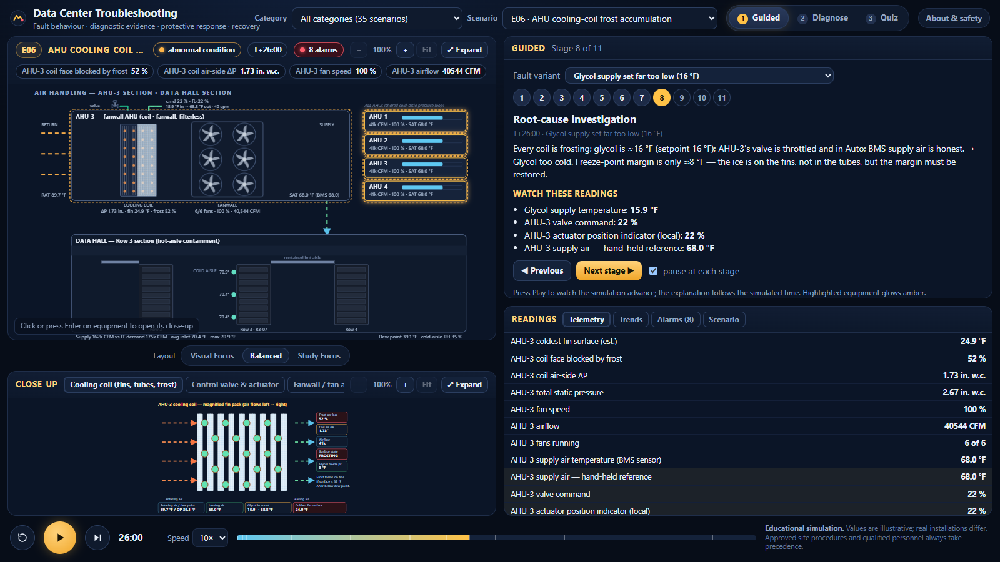

# Data Center Troubleshooting

**[▶ Launch the simulator](https://samfclement.github.io/Data-Center-Troubleshooting/)**

An interactive training simulator about how critical-facility equipment behaves when it is healthy,
how faults develop and spread through connected systems, and how to reason from **evidence** to a
**root cause** and a **safe operational response**. It is the third simulator in a series with
[Data Center Thermodynamics](https://samfclement.github.io/Data-Center-Thermodynamics/) and
[Data Center Power Distribution](https://samfclement.github.io/Data-Center-Power-Distribution/).

## Use it offline

The whole application is the single file [`index.html`](index.html): no server, account, internet
connection or installation needed.

1. Open [`index.html`](index.html) in this repository and choose **Download raw file**, or save the live
   page from your browser (*Save page as… → Web page, HTML only*).
2. Open the saved file in a current browser (Edge, Chrome, Firefox or Safari).

The application makes no network requests. Only the chosen panel layout is stored in your browser.

## Curriculum: 35 scenarios, 97 fault variants

| Category | Scenarios |
|---|---|
| **A — Electrical distribution & UPS** | utility undervoltage, UPS rectifier fault, inverter failure and static bypass, battery degradation, breaker trip, A/B redundancy and overload |
| **B — Generators & transfer** | failure to start, failure to accept load, overheating, ATS failure to transfer, abnormal utility restoration |
| **C — Chillers & refrigeration** | failure to start, high condenser pressure, low evaporator flow, reduced capacity, compressor/motor protection trip, refrigerant loss |
| **D — Cooling water, pumps & towers** | pump failure, restricted strainer, control-valve actuator/feedback failure, tower fan failure, tower performance loss, condenser-water pump failure |
| **E — Air handling & environment** | AHU fan/VFD failure, blocked filter, server-inlet hot spot, coil valve malfunction, humidity/dew point, cooling-coil frost |
| **F — Controls & incidents** | BMS communication loss, faulty sensor, command/feedback mismatch, water leak, fire alarm/suppression supervisory, cascading common-dependency failure |

Every scenario runs on one shared engine: coupled electrical and cooling models with BMS, leak and fire
systems, live telemetry, trends and alarms.

## Learning modes

- **Guided:** a narrated sequence from normal operation through the initiating fault, its symptoms,
  the evidence, the root cause, the protective response and a controlled recovery. Choose the fault variant;
  press Play and the explanation follows the simulated time.
- **Diagnose:** you arrive at the abnormal condition without being told the cause. Inspect
  telemetry, trends, alarms, local indications and records. A diagnosis is accepted only when it is
  correct *and* backed by evidence that rules out the alternatives. Then choose a protective response and
  sequence the recovery.
- **Quiz:** six scenario-specific questions, reshuffled on every retake.

## Visual controls

- Click (or tab to and press **Enter** on) equipment in the system overview to open its close-up.
- **Zoom:** both the overview and the close-up have **−** / **+** (100–400 %) and **Fit**. The mouse
  wheel zooms toward the pointer; when zoomed, drag to pan. On touch screens, pinch to zoom and drag with
  one finger.
- **Expand / Restore** enlarges either panel; **F** toggles the overview.
- **Layout presets:** *Visual Focus*, *Balanced* and *Study Focus*.
- Playback: Space (play/pause), **.** (step 10 s), **R** (reset), speed 1×–60×.

## Safety disclaimer

This is an **educational simulation**, not a manufacturer-certified engineering model and not an
operating procedure. All values, setpoints, thresholds and time scales are illustrative, and fault
progression is accelerated. Real installations differ. Never switch, isolate, reset, bypass or disable
equipment or protection systems based on this application. Approved site-specific procedures,
manufacturer instructions and the direction of qualified, authorized personnel always take precedence.
Life safety comes first.

Known visual limitations: a few fault markers in some drawings are not shown (for example
stopped-fan crosses, filter dust and leak markers), although the readings, alarms and explanations for those
faults are correct.

## Author

Created by [samfclement](https://github.com/samfclement). This repository contains only the published
application; it is updated automatically from a private source repository.
